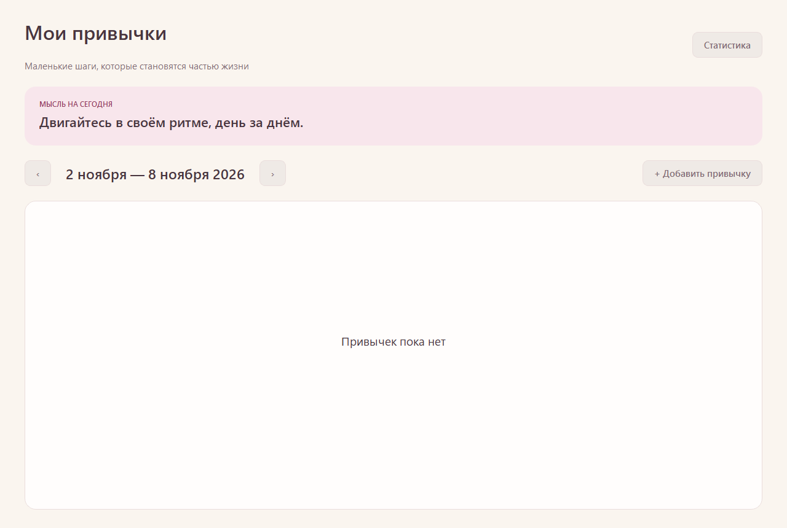

# Этап 1: сборка, PostgreSQL и проверки

## Что реализовано

Каркас Qt Widgets в согласованной палитре, текущая неделя при запуске, одна случайная цитата из пяти встроенных, внешний INI, QPSQL, проверка имени базы и версии схемы, транзакционная инициализация пустой базы, сообщения о сбоях с повтором. Функции этапов 2–4 пока недоступны.

## Сборка

В Windows PowerShell из корня проекта:

```powershell
.\scripts\build.ps1 -Test
```

Скрипты используют `D:\Qt` и `C:\Program Files\PostgreSQL\18\bin`; другие пути передаются параметрами `-QtRoot` и `-PostgresBin`. PowerShell-файлы сохранены в UTF-8 с BOM для Windows PowerShell 5.1. Исполняемый файл — `build\qt\habit_tracker.exe`.

Qt moc не смог создать файлы по пути с кириллицей, поэтому сборка временно подключает H: через subst к папке проекта. Исходники не копируются, в finally диск отключается. Для занятой H: можно выбрать другую свободную букву через `-BuildDrive`. Уже существующий CMake-кэш помнит выбранную букву; при её смене каталог `build/qt` следует предварительно переименовать, чтобы получить чистую сборку. Не запускайте параллельные сборки с одной буквой. Системный PATH не меняется.

## Первоначальная настройка базы

Нужен **текущий** пароль администратора PostgreSQL. Новый пароль роли приложения не заменяет его.

```powershell
.\scripts\setup-database.ps1
```

Скрипт запрашивает текущий пароль `postgres`, проверяет вход, затем запрашивает новый пароль `habit_tracker_sdd_app`. При существующей роли пароль не сбрасывает. Роль создаётся без superuser/createdb/createrole/replication. Создаются только `habit_tracker_sdd` и `habit_tracker_sdd_test`, обе принадлежат этой роли. Скрипт не удаляет базы; если имя занято базой другого владельца, останавливается. После частичного успеха возможен повторный запуск. Для администратора с другим именем используйте `-AdminUser`, для другого порта — `-Port`.

Пароли используются только в памяти процесса, SQL передаётся через stdin, пароль не попадает в аргументы запуска. При ошибке выводятся название шага и сообщение сервера с удалением введённых секретов. Для SQL, содержащего новый пароль, подробности полностью скрыты. Русские сообщения декодируются как UTF-8 либо системная кодировка Windows. Изменения конфигурации сервера и сброс текущего пароля администратора скрипт не выполняет.

В `%LOCALAPPDATA%\HabitTrackerSDD\connection.ini` создаётся конфигурация без пароля. Уже существующий файл не перезаписывается; его нужно проверить по [образцу](../config/connection.example.ini). Можно выбрать другой файл переменной `HABIT_TRACKER_CONFIG`. Пароль приложение читает только из `HABIT_TRACKER_DB_PASSWORD`.

При первом успешном входе приложение атомарно создаёт схему из [001_initial.sql](../db/001_initial.sql). Повторный запуск схемы не стирает данные. Неподдерживаемая версия и посторонние таблицы без версии вызывают отказ. Приложение не создаёт базы или роли самостоятельно.

## Запуск

```powershell
.\scripts\run.ps1
```

Скрипт запросит пароль роли приложения, задаст окружение только на время работы окна и восстановит предыдущие значения после его закрытия. `-NoPasswordPrompt` использует уже заданное окружение или вход без пароля, если это разрешено сервером. Отсутствующая конфигурация или отказ сервера показывают понятное сообщение с «Повторить» и «Закрыть».

## Автоматические проверки

`build.ps1 -Test` проверяет загрузку QPSQL с libpq, отказ от неподходящей базы до сетевого запроса, сообщение без параметров соединения, отклонение пароля в INI и неверного порта, реальное окно Qt и повтор соединения при ошибке. Тесты сохраняют текстовые результаты в `build/qt/database-results.txt` и `build/qt/window-results.txt`, снимок окна — `build/qt/window-error.png`. Эти артефакты исключены из Git.

Без флага обе проверки с реальной БД (схема/данные и успешное окно) имеют статус SKIP, что не означает их успешное прохождение. После подготовки баз они запускаются с паролем роли в окружении текущего PowerShell:

```powershell
$secure = Read-Host 'Пароль роли приложения' -AsSecureString
$pointer = [Runtime.InteropServices.Marshal]::SecureStringToBSTR($secure)
$previousPassword = $env:HABIT_TRACKER_DB_PASSWORD
try {
    $env:HABIT_TRACKER_DB_PASSWORD = [Runtime.InteropServices.Marshal]::PtrToStringBSTR($pointer)
    .\scripts\build.ps1 -Integration
} finally {
    [Runtime.InteropServices.Marshal]::ZeroFreeBSTR($pointer)
    $secure.Dispose()
    $env:HABIT_TRACKER_DB_PASSWORD = $previousPassword
}
```

Интеграционные тесты принудительно используют только `habit_tracker_sdd_test`: версия схемы, повторная инициализация и сохранение строки, уникальная пара привычка/дата, каскадное удаление, отказ от неизвестной версии схемы, успешное окно без кнопки повтора. Свои строки удаляют/откатывают. Продукционная база в тестах запрещена. Снимок успешного окна сохраняется в `build/qt/window-connected.png`, только если проверка проходит. Это не полный сценарий ручной приёмки приложения.

## Фактический статус

08.11.2026 на временном PostgreSQL 18.6, слушавшем только 127.0.0.1:55439, обе интеграционные программы прошли без пропусков: 7 PASS у DatabaseSmokeTest и 4 PASS у WindowSmokeTest (с учётом init/cleanup). Применение схемы от роли без административных прав, сохранение данных при повторном открытии, уникальность отметки, каскадное удаление, отказ от неизвестной версии и успешное окно подтверждены. После тестов временный сервер остановлен; основной localhost:5432 не изменялся.



08.11.2026 после явного разрешения пользователя [план восстановления доступа](POSTGRES_RECOVERY.md) выполнен: пароль postgres сменён, исходный pg_hba.conf восстановлен побайтно и проверен по SHA-256, ошибочный пароль снова отклоняется. Служба не перезапускалась.

На основном localhost:5432 созданы habit_tracker_sdd и habit_tracker_sdd_test с владельцем habit_tracker_sdd_app. Подтверждено отсутствие у роли superuser/createdb/createrole/replication. Несекретная конфигурация находится в `%LOCALAPPDATA%\HabitTrackerSDD\connection.ini`. Штатный setup-database.ps1 выполнен успешно. Пароли не сохранены в репозитории.

Повторный build.ps1 -Integration на основном сервере: CTest 2/2, 7 PASS у DatabaseSmokeTest и 4 PASS у WindowSmokeTest, ноль ошибок и пропусков. Снимок выше обновлён по результатам успешного окна на habit_tracker_sdd_test основного сервера.

Собранный habit_tracker.exe дважды запущен отдельным процессом с рабочей базой habit_tracker_sdd. Приложение создало схему v1, после второго запуска версия и таблицы сохранились; начальные количества привычек и отметок — ноль. Проверочные процессы запускались скрыто, CloseMainWindow не завершил их, поэтому после SQL-проверки они остановлены принудительно. Обычное ручное закрытие приложения и полный сценарий приёмки ещё не проверялись; сохранение данных между соединениями проверено интеграционно на тестовой базе.

Этап 1 завершён в рамках его критериев. Следующий этап — создание, переименование и удаление привычек. Итоги, ограничения и время — в [журнале](WORK_LOG.md).
