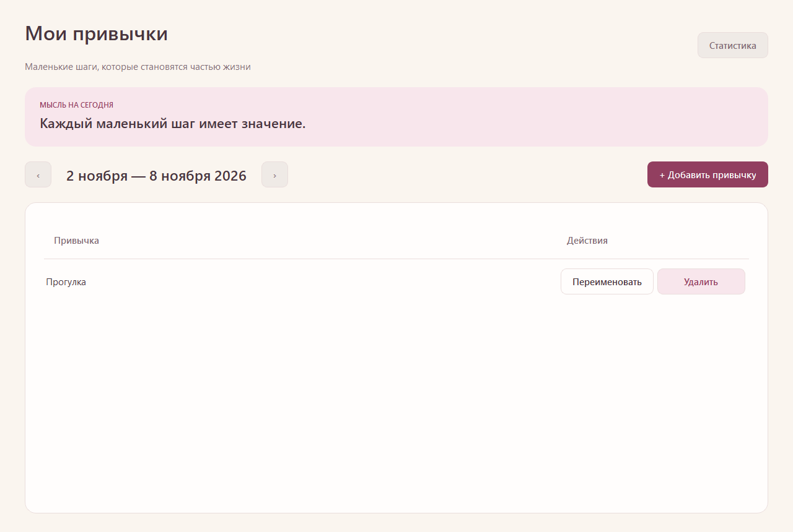
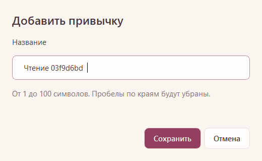

# Этап 2: управление привычками

Завершён 08.11.2026. Реализованы создание, переименование и подтверждаемое удаление привычек. Неделя пока не переключается, отметки, серии и статистика относятся к этапам 3–4.

## Поведение

- В пустом списке доступны верхняя кнопка добавления и приглашение создать первую привычку. После сохранения показывается список с действиями рядом с каждой строкой.
- Название обрезается по краям; пустое, состоящее из пробелов, многострочное или длиннее 100 единиц QString отклоняется. Длинный ввод не обрезается молча. Одинаковые названия разрешены; операции обращаются к id.
- Создание и переименование используют одну форму. Enter сохраняет корректное название, Escape и «Отмена» закрывают без записи. Ошибка записи оставляет введённый текст в форме с сообщением.
- Удаление предупреждает об удалении всей истории. По умолчанию выбрана отмена. Реальное удаление выполняется по id, отметки удаляет внешний ключ ON DELETE CASCADE.
- Список сортируется по created_at, затем id; переименование порядок не меняет. Длинные названия сокращаются в строке; подсказка показывает полное название как обычный текст, включая символы разметки.
- Запросы параметризованы. Необработанные сообщения драйвера и параметры соединения в пользовательские ошибки не включаются. При ошибке загрузки не показывается ложный пустой список.

## Настоящий интерфейс





Снимки сделаны автоматическим UI-тестом на habit_tracker_sdd_test. Случайный суффикс в названии на снимке диалога — только тестовое имя, не часть интерфейса. В рабочую базу демонстрационные привычки не добавлялись. Недельные клетки и серии появятся на следующем этапе.

## Файлы и проверки

Добавлены HabitRepository (валидация и SQL), HabitDialog (форма), HabitRepositoryTest и HabitUiTest. Обновлены MainWindow, CMake и вывод отчётов scripts/build.ps1. Схема остаётся v1, миграция не потребовалась.

Сборка и проверки:

```powershell
.\scripts\build.ps1 -Integration
```

Пароль должен быть в окружении процесса, способ закрытого ввода приведён в [STAGE1.md](STAGE1.md). Все интеграционные данные принудительно направляются только в habit_tracker_sdd_test; CTest resource lock сериализует обращения четырёх наборов к этой базе даже при параллельном запуске CTest.

Итоговый запуск: CTest **4/4 успешны**, ноль FAIL/SKIP; Qt Test: DatabaseSmokeTest 7 PASS, WindowSmokeTest 4 PASS, HabitRepositoryTest 13 PASS, HabitUiTest 4 PASS (включая служебные init/cleanup).

Проверено фактически:

- Пустота, пробелы Unicode, кириллица, границы 100/101, перенос строки, нулевой символ и разделитель абзацев.
- Создание дублей, SQL-подобное название как буквальный текст, стабильный порядок, сохранённое переименование в новом соединении.
- Сохранение существующей отметки при переименовании и её каскадное удаление через реальный метод репозитория.
- Закрытое соединение не меняет предоставленный список и не имитирует успешную запись.
- Форма не обрезает длинное имя; инъекция ошибки callback сохраняет текст и оставляет диалог открытым. Реальный обрыв сервера во время записи не моделировался.
- Клики и клавиши в настоящем Qt-интерфейсе: добавление, Enter при переименовании, отмена добавления и переименования, отмена удаления и подтверждение удаления.
- Повторное открытие окна с новым подключением показывает сохранённое имя; окно программно закрывается через QWidget::close. Полный ручной перезапуск habit_tracker.exe пользователем на этом этапе отдельно не выполнялся.
- Снимки основного окна и формы визуально осмотрены. SQL-проверка подтвердила очистку тестовых строк и отсутствие изменений в рабочей базе.

## Ручная проверка пользователем

```powershell
.\scripts\run.ps1
```

Добавить «Чтение», попробовать имя из пробелов, переименовать в «Чтение 20 минут», отменить второе переименование и удаление. Закрыть и запустить приложение повторно, убедиться в сохранении имени, затем подтвердить удаление. Этот пользовательский сценарий предлагается для обратной связи; он не записан как уже выполненный. Общая приёмка из SPEC.md остаётся для этапа 5.
