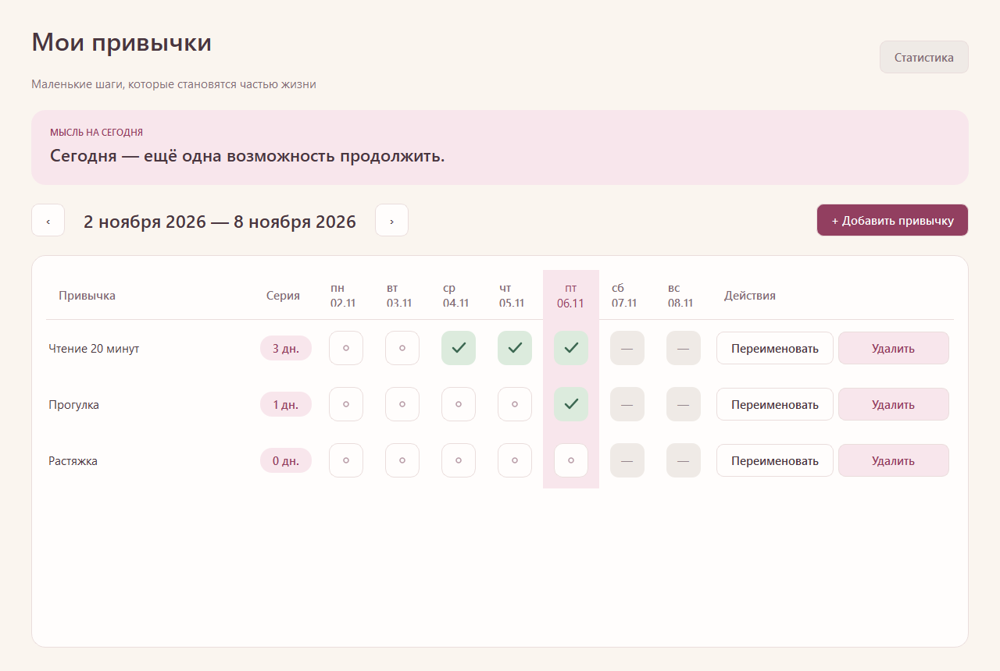

# Этап 3: неделя, отметки и серии

Завершён 08.11.2026. Доступны недельная таблица, переходы на ±7 календарных дней, установка/снятие отметок и текущие серии. Экран статистики относится к этапу 4.

## Поведение

- При запуске открывается неделя локального сегодня, с понедельника по воскресенье. Заголовки показывают даты; диапазон корректно пересекает месяц и год.
- Кнопки перехода работают и для будущих недель. Будущие даты нельзя менять. Прошлые даты доступны, в том числе до создания привычки.
- Отметка переключается мышью или пробелом на клетке в фокусе. Пока запрос выполняется, клетка недоступна. После загрузки сохранённого состояния фокус возвращается к тому же дню; сохраняется положение прокрутки.
- PostgreSQL хранит одну строку на пару привычка/DATE. Повторная установка использует ON CONFLICT DO NOTHING, повторное снятие удаляет точную пару и не считается ошибкой.
- Серия начинается с сегодня, если сегодня выполнено; иначе — со вчера. Пустой старт даёт 0; пропуск останавливает счёт. Используется вся история, включая дни вне недели и за пределами 30 дней. Переходы недель не меняют текущую серию.
- Сегодня выделяется розовым столбцом и заголовком, выполнение — зелёной клеткой с векторной галочкой, серии — розовыми бейджами. Будущие клетки серые с тире. Цвет не является единственным признаком состояния.
- Дата проверяется перед действием, при активации окна и таймером раз в секунду. Смена дня пересчитывает серии/доступность, сохраняя выбранную неделю. При обратном переводе часов будущие сохранённые отметки не стираются, становятся недоступны и не участвуют в текущей серии.
- Диапазон — годы 1–9999. Навигация за него блокируется. В последней поддерживаемой неделе 9999 года дни за 31 декабря показываются тире и недоступны; диапазон заголовка заканчивается последней поддерживаемой датой.

## Интерфейс

Это снимок настоящего UI-теста с подставной датой 06.11.2026, выбранной для сопоставления с макетом. Часы Windows не менялись. Три демонстрационные привычки существовали только в habit_tracker_sdd_test и удалены после проверки. В обычном приложении сегодня берётся из локальной даты Windows.

## Реализация

Добавлены Calendar (даты и серии), CompletionRepository (снимок/запись отметок), CalendarTest, CompletionRepositoryTest и WeekUiTest. MainWindow расширен до десяти столбцов: название, серия, семь дней и действия. CRUD-тесты адаптированы к новому расположению действий.

Привычки и отметки загружаются в транзакции REPEATABLE READ READ ONLY, чтобы таблица и серии использовали один снимок БД. Даты передаются как QDate/DATE без UTC и времени суток. При ошибке записи выполняется повторная загрузка сохранённых данных; если чтение также не удалось, показывается ошибка с повторным подключением, а не ложное успешное состояние.

Схема остаётся v1: существующий первичный ключ уже обеспечивает уникальность пары. Миграции и изменения данных рабочей базы для тестов не требовались.

## Запущенные проверки

Сборка и итоговый `scripts/build.ps1 -Integration` успешны. CTest: **7/7**, ноль FAIL/SKIP. Qt Test: DatabaseSmokeTest 7 PASS, WindowSmokeTest 4, HabitRepositoryTest 13, HabitUiTest 4, CalendarTest 14, CompletionRepositoryTest 4, WeekUiTest 3; числа включают служебные init/cleanup.

Проверены:

- Понедельник/воскресенье, граница года, 29 февраля, даты календарных недель переходов летнего времени, границы 1 и 9999 и запрет выхода за них.
- Серии 3/2/0/1 по примерам спецификации, граница года и високосного месяца, непрерывная история 70 дней, вчерашняя серия после полуночи и обрыв на следующий пропущенный день.
- Реальная PostgreSQL-запись одного дня дважды: одна строка. Двойное снятие: ноль строк. Запрет будущей установки и снятия, сохранение будущей записи после обратного перевода даты, ошибка внешнего ключа без фиктивного успеха.
- Round trip дат 01.01.0001, 29.02.2024, 31.12.9999 через QPSQL; новое соединение видит сохранённые отметки.
- Настоящие UI-клики и Space: отметка сегодня, снятие, восстановление, изменение вчера, пересчёт серии, прежняя/будущая недели, ретроспективная отметка до создания привычки.
- Смена дня и обратный перевод даты через DateProvider без изменения Windows; сохранение выбранной недели при переходе на понедельник; игнорирование устаревшего клика по дню, который уже стал будущим.
- Сохранение фокуса после записи и повторное нажатие Space; горизонтальная прокрутка при окне 800×600; новое окно с отдельным подключением восстанавливает отметку и серию.
- Регрессия этапов 1–2, визуальный осмотр итогового снимка и SQL-проверка удаления тестовых строк.

Ограничения проверки: реальная полночь, смена часового пояса/часов Windows, обрыв сети непосредственно во время записи, все режимы DPI и полный пользовательский перезапуск exe вручную не выполнялись. Дата в UI-тесте подставляется программно; перепроверка сохранения в новой сессии БД и новом окне выполнена. Полная ручная приёмка остаётся этапом 5.

## Ручной сценарий для обратной связи

Запустить `scripts/run.ps1`, создать привычку, отметить сегодня и вчера, снять сегодня, проверить серию, перейти на прошлую и будущую недели. Закрыть и открыть приложение, проверить отметки. Этот сценарий предлагается пользователю и пока не записан как выполненный.
