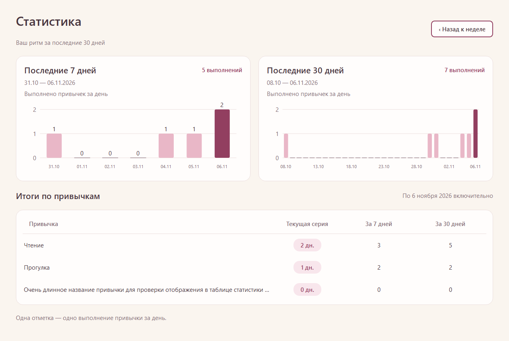
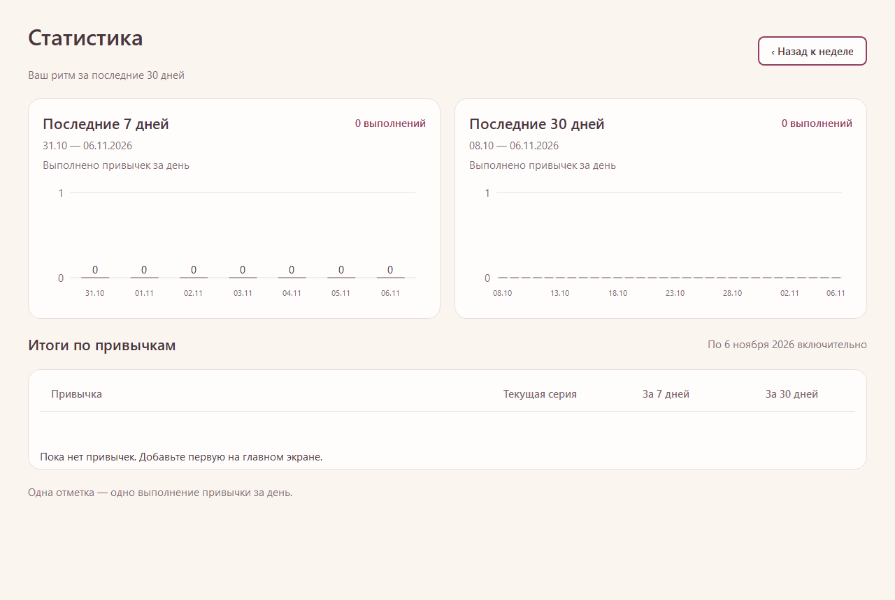
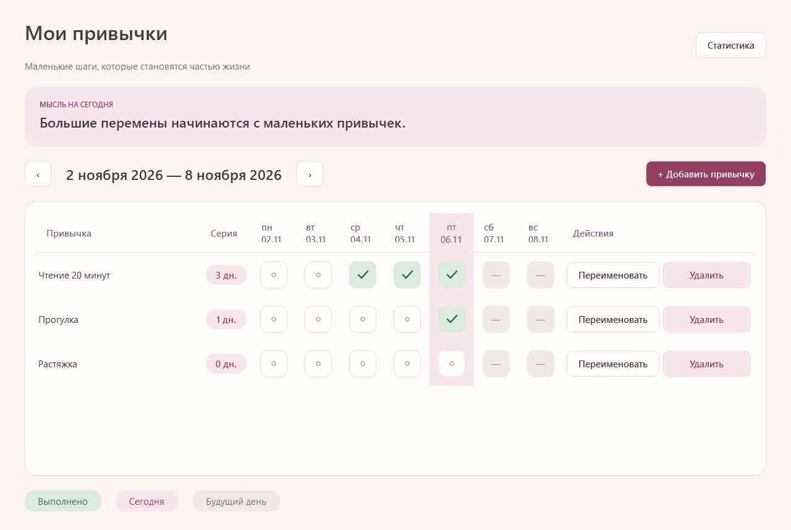

# Этап 4: статистика и оформление

Завершён 08.11.2026. Кнопка «Статистика» открывает отдельный экран в том же окне; «Назад к неделе» возвращает к выбранной ранее неделе. Реализованы два графика, общие суммы и таблица по привычкам. Дополнительные метрики и фильтры не добавлялись.

## Правила расчёта

- 7 дней — [сегодня−6; сегодня], 30 дней — [сегодня−29; сегодня], обе границы включены. Нулевые дни присутствуют.
- Каждый столбец показывает количество выполненных привычек за дату; ось Y целочисленная. Сумма над графиком равна сумме его столбцов и сумме соответствующей колонки привычек.
- Таблица содержит все существующие привычки, текущую серию и числа отметок за 7/30 дней. Привычка без отметок имеет нули. Переименование меняет подпись, удаление убирает вклад вместе с историей.
- Будущие даты не входят в показатели. Серия считается по всей истории по прежнему правилу сегодня/вчера, поэтому может превышать 30, даже когда графики показывают только последние периоды.
- Данные берутся из сохранённых отметок одним согласованным снимком REPEATABLE READ READ ONLY. Отдельные таблицы счётчиков не создаются, схема остаётся v1.
- Обновление происходит при открытии статистики, возврате фокуса и смене локального дня. Ошибка скрывает графики и таблицу, показывает сообщение и «Повторить»; ошибочное чтение не превращается в нули. Повтор восстанавливает соединение и заново читает данные.
- У нижней границы поддерживаемых дат период обрезается по 01.01.0001; дни до разрешённого диапазона не рисуются. Это проверено отдельно, для обычных дат всегда отображаются ровно 7 и 30 дней.

## Настоящие экраны

Снимок получен UI-тестом с подставной датой 06.11.2026 и контрольными данными из SPEC.md: «Чтение» — 3/5, «Прогулка» — 2/2, суммы — 5/7. Третья привычка демонстрирует длинное название и нулевую историю. Это другой набор отметок, чем демонстрация макетов с суммами 11/44; формулы остаются согласованными.

Оформление сохраняет розовую/бежевую палитру и зелёные отметки. В статистике серии выделены теми же бейджами, сегодняшний столбец графика — более насыщенным розовым. Графики рисуются QPainter, без внешних ресурсов. Подсказка показывает точную дату и значение; данные по датам также включены в accessible description. На главном экране добавлены короткие пояснения состояний клеток.

При 1280×860 три привычки помещаются без полос прокрутки в статистике; при 800×600 доступна прокрутка. Длинные названия сокращаются, полный текст виден в подсказке. Для большого числа привычек таблица и экран прокручиваются. Заголовки осей и кнопки подписаны на русском.

## Реализация и проверки

Добавлены Statistics (чистые вычисления), BarChart (рисование/подсказки), StatisticsPage (экран), StatisticsTest и StatisticsUiTest. MainWindow переключает страницы, сохраняет неделю и обновляет данные. CMake и build.ps1 включают девять тестовых программ/отчётов. Подключение или схема PostgreSQL не изменялись.

Итоговый `scripts/build.ps1 -Integration`: **CTest 9/9**, ноль FAIL/SKIP. Qt Test: прежние 7+4+13+4+14+4+3 PASS, StatisticsTest 5 PASS, StatisticsUiTest 4 PASS; числа включают init/cleanup.

Проверены фактически:

- Контрольный набор SPEC.md, включение D−6/D−29 и исключение D−7 из 7 дней / D−30 из 30 дней, игнорирование будущих отметок и записей удалённого id.
- Нулевые дни, отсутствие привычек/истории, суммы по столбцам и привычкам, переименование и удаление, переход года и 29 февраля, первая и последняя поддерживаемые даты.
- Серия 70 дней при ограниченных графиках, пересчёт периода на следующий день.
- UI на реальной habit_tracker_sdd_test: открытие пустой статистики, чтение записанных контрольных отметок, обновление после записи из другого соединения, переименования и удаления, обновление дня, возврат к выбранной неделе.
- Строка длиной 100 символов, размещение всей статистики при 1280×860, отсутствие лишних горизонтальных/вертикальных полос при трёх строках, наличие прокрутки при 800×600.
- Показ ошибки вместо видимых устаревших/нулевых данных и сигнал повтора. Эта ошибка введена напрямую в StatisticsPage; отключение основного PostgreSQL для UI-теста не выполнялось.
- Визуальный осмотр окончательных снимков, регрессия этапов 1–3 и SQL-проверка удаления тестовых данных.

Все демонстрационные строки создавались только в habit_tracker_sdd_test и удалены. Рабочая база не заполнялась тестовыми данными. Часы Windows не менялись. Полная ручная приёмка, реальный обрыв сервера, все режимы DPI и проверка программы после полного пользовательского перезапуска остаются для этапа 5.

## Следующий этап

Итоговая приёмка по SPEC.md, инструкция запуска/доставки и отчёт о фактическом процессе сравнения. Для текущей проверки можно запустить scripts/run.ps1, открыть статистику после нескольких отметок и вернуться к неделе. Этот пользовательский сценарий ещё не отмечен выполненным.
