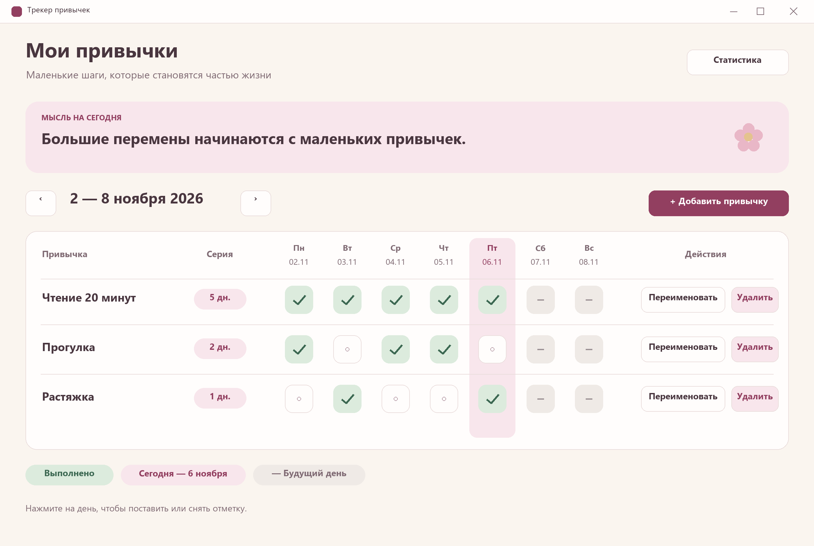
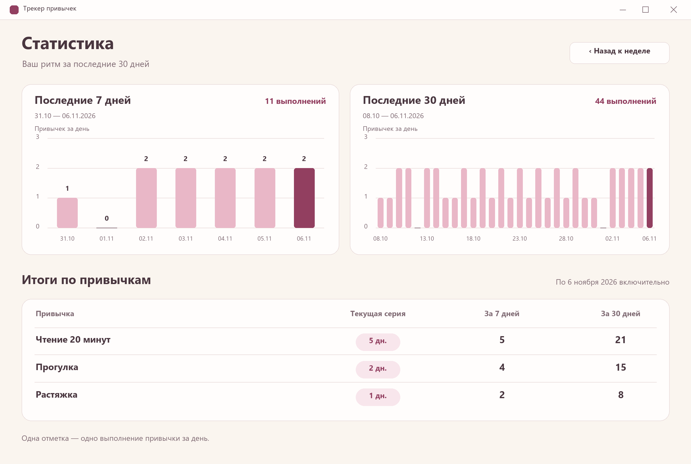
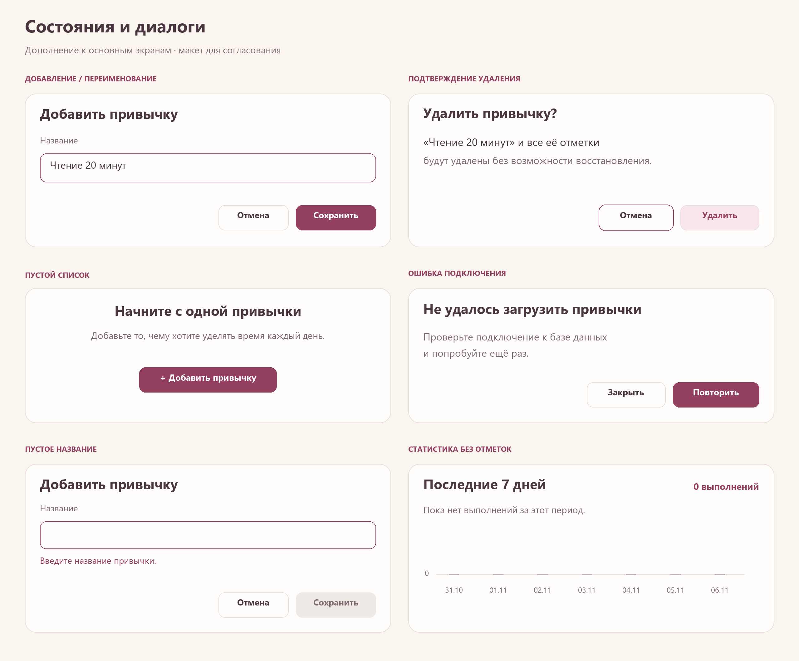

# Макеты интерфейса v0.1

**Статус: утверждены пользователем вместе со спецификацией 06.11.2026.**

Это статичные изображения согласованного интерфейса, а не работающий прототип приложения. Кнопки на изображениях не нажимаются. После согласования начат этап 1; состояние реализации и проверок описано в корневом README и журнале.

## Главное окно

[Векторный исходник](01-week.svg)

Неделя 2–8 ноября 2026. Пятница, 6 ноября, показана как сегодня: розовое выделение всего столбца. Зелёные галочки — выполнено, пустая клетка — доступна для отметки, серые клетки с тире — будущие даты. Серии остаются видимыми рядом с названиями. Кнопки переименования и удаления подписаны явно.

Переходы недель расположены рядом с диапазоном, добавление — над таблицей, статистика — в правом верхнем углу. На картинке показаны три привычки; при большем количестве прокручиваются строки. Длинное название сокращается с подсказкой. Выбранная неделя сохраняется при переходе в статистику и обратно.

## Статистика

[Векторный исходник](02-statistics.svg)

Два графика количества выполненных привычек по дням с общими суммами и таблицей по привычкам. Окна включают 31.10–06.11 и 08.10–06.11.2026 соответственно. Нулевые дни показаны на базовой линии. Текущий день выделен более насыщенным розовым столбцом. Процентов и дополнительных показателей нет. На 30-дневном графике подписи дат разрежены для читаемости, каждый день имеет отдельный столбец; при реализации подсказка показывает точную дату и значение.

## Диалоги и состояния

[Векторный исходник](03-states.svg)

На одном листе показаны отдельные состояния, которые не отображаются одновременно:

- Добавление привычки. Переименование использует ту же форму с заголовком «Переименовать привычку» и текущим названием.
- Подтверждение удаления вместе с историей; начальный фокус — на отмене.
- Пустой список привычек.
- Ошибка подключения с повтором или закрытием.
- Пустое название: пояснение рядом с полем, сохранение недоступно.
- Статистика без отметок: нулевые значения и понятная подпись.

## Визуальные ориентиры

| Элемент | Предложение |
| --- | --- |
| Фон | Бежевый `#FAF5EF` |
| Карточки | Тёплый белый `#FFFDFC` |
| Мягкий розовый | `#F8E6EC` |
| Основной акцент | Тёмный розовый `#923F60` |
| Выполнение | Светлый зелёный `#DCEBDD`, галочка `#3C6852` |
| Основной текст | `#49363F` |
| Шрифт | Segoe UI, обычный и полужирный |
| Размерный ориентир | Главное окно и статистика — 1280×860 логических пикселей; PNG экспортированы в масштабе 2× |

В Qt Widgets предполагаются QTableView/делегаты для таблицы, QDialog для форм, QPainter для графиков и оформление палитрой/QSS. Это предложение реализации, не уже созданный код. При меньшем размере окна таблицы и графики прокручиваются. Реальное масштабирование Windows, управление фокусом, контраст на мониторе пользователя и отображение Qt будут проверены на этапе реализации; эти проверки пока не выполнены.

## Пример данных и выполненные проверки

Все цифры макетов получены из одного демонстрационного набора дат в [sample-data.json](sample-data.json), не из PostgreSQL. Фиксированная дата примера — 06.11.2026. Это иллюстрация будущих вычислений, не проверка реализации приложения.

| Привычка | Серия | 7 дней | 30 дней |
| --- | --- | --- | --- |
| Чтение 20 минут | 5 | 5 | 21 |
| Прогулка | 2 | 4 | 15 |
| Растяжка | 1 | 2 | 8 |
| Суммы выполнений | — | 11 | 44 |

При экспорте выполнены утверждения о числах, изображения открыты агентом для визуального осмотра. На первом осмотре найден отсутствующий символ галочки в текстовой легенде; он убран из текста, галочки клеток нарисованы векторными линиями. XML-структура трёх SVG разобрана успешно, целостность трёх PNG проверена через Pillow. Приложение, его доступность с клавиатуры и база данных не проверялись.

## Что согласовать

1. Подходят ли цвета, шрифт, размеры и плотность таблицы?
2. Подходят ли выделение сегодня, зелёные галочки и отдельные розовые показатели серии?
3. Подходят ли размещение действий, два графика и таблица статистики?
4. Подходят ли диалоги и показанные пустые/ошибочные состояния?

Согласование зафиксировано после явного ответа пользователя. Последующие изменения поведения или оформления сначала согласуются.
